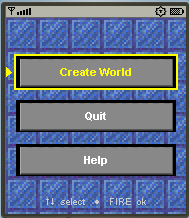
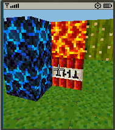
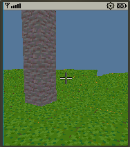
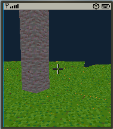
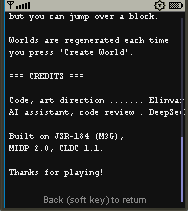
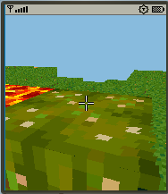

<div align="center">

# 🧱 VoxelVerseJME

**Воксельный 3D-сэндбокс для Java 2 Micro Edition**


Кубический мир в кармане. Гравитация, прыжок, ломание и установка блоков,  
цикл дня и ночи — всё на аппаратном 3D-ускорителе телефона.

[Возможности](#-возможности) · [Управление](#-управление) · [Сборка](#-сборка) · [Архитектура](#-архитектура) · [FAQ](#-faq)

</div>

---

## 📸 Скриншоты

<div align="center">

| Главное меню | Геймплей днём | Закат |
|:---:|:---:|:---:|
|  |  |  |

| Ночь | Экран справки | Прыжок на блок |
|:---:|:---:|:---:|
|  |  |  |


</div>

---

## ✨ Возможности

### 🎮 Геймплей

- **Гравитация и прыжок** — игрок это AABB 0.6 × 1.8 × 0.6, вертикальная коллизия сажает на верх блока, горизонтальная не даёт пройти сквозь стену
- **Разрушение блоков** — луч взгляда идёт по воксельной сетке алгоритмом DDA (Amanatides & Woo)
- **Установка блоков** — блок ставится в пустую клетку рядом с гранью, а не поверх существующего
- **9 типов блоков** — трава, земля, камень, бедрок, TNT, кактус, лава, синий демонический камень, тыква
- **Цикл дня и ночи** — плавная интерполяция цвета неба через smoothstep
- **Жёсткие границы мира** — за пределы 32³ выйти невозможно

### 🎨 Интерфейс

- **Заставка** с логотипом (`logo.png`), автоматический переход в меню
- **Главное меню** — текстурированный фон, кнопки с текстурой `button.png`, подсветка выбора
- **Экран справки** — управление, геймплей, авторы, прокрутка пальцем
- **Прицел** — белый крест с чёрной обводкой, читается на любом фоне
- **Игровое меню** — быстрый выход, доступ к справке без потери мира

### ⚙️ Технические

- **Единый меш** — все видимые грани запекаются в один `Mesh` с `TriangleStripArray`
- **Отсечение невидимых граней** — грань рисуется только если соседний блок — воздух
- **Кэш тригонометрии** — `sin/cos` считаются один раз за кадр и переиспользуются
- **Явное освобождение M3G-ресурсов** — меш освобождается при выходе в меню, никаких утечек
- **Простейший генератор** — value-noise 8×8 + билинейная интерполяция, высоты 3–5

---

## 🕹 Управление

| Клавиша | Действие |
|:---:|:---|
| `2` / `↑` | Движение вперёд |
| `8` / `↓` | Движение назад |
| `4` / `←` | Шаг влево |
| `6` / `→` | Шаг вправо |
| `1` | Прыжок (только с земли) |
| Стрелки | Поворот головы / наклон взгляда |
| `FIRE` / `5` | Сломать блок / поставить блок |
| `#` | Переключить режим `BREAK` ↔ `PLACE` (в `PLACE` — сменить тип блока) |
| `*` | Сменить тип блока |
| Софт-клавиша `Menu` | Выход в главное меню |

---

## 📦 Сборка

### Требования

- **JDK 8+** (для сборки)
- **Sun Java Wireless Toolkit 2.5.2** или **NetBeans с J2ME-модулем**
- **Телефон** с поддержкой `CLDC 1.1` + `MIDP 2.0` + `JSR-184`

### Компиляция

```bash
# Клонировать репозиторий
git clone https://github.com/elinvar-labs/VoxelVerseJME.git
cd VoxelVerseJME

# Собрать через Ant
ant clean build

# Готовый JAR появится в dist/
ls -lh dist/VoxelVerseJME.jar
# -rw-r--r--  1 user  staff   180K  VoxelVerseJME.jar
```

### Установка на телефон

1. Скопируйте `dist/VoxelVerseJME.jar` на телефон (по Bluetooth, USB или SD-карте)
2. Откройте файл через встроенный файловый менеджер — установка запустится автоматически
3. Найдите иконку **VoxelVerseJME** в меню приложений

> ⚠️ **Важно:** телефон должен поддерживать **JSR-184 (Mobile 3D Graphics)**.  
> Проверить: `Настройки → О телефоне → Java` → должен быть пункт «Mobile 3D Graphics» или «JSR-184».

### Запуск в эмуляторе

```bash
# Sun WTK
$WTK_HOME/bin/emulator -Xdescriptor:dist/VoxelVerseJME.jad
```

---

## 🏗 Архитектура

```
voxelversejme/
├── VoxelMIDlet.java       — точка входа, управление экранами
├── LogoCanvas.java        — заставка с логотипом
├── MenuCanvas.java        — главное меню
├── HelpCanvas.java        — экран справки
├── GameCanvas.java        — игровой 3D-экран (основной файл)
├── VoxelWorld.java        — данные мира + генератор
└── VoxelMeshBuilder.java  — построение M3G-меша

res/
├── logo.png               — логотип для заставки
├── menu_bg.png            — фон главного меню
├── button.png             — текстура кнопок
└── atlas.png              — атлас блоков 256×256
```

### Поток управления

```
      [VoxelMIDlet]
            │
    ┌───────┼───────┬──────────┐
    ▼       ▼       ▼          ▼
 [Logo]  [Menu]  [Game]     [Help]
           │       ▲          │
           │       │          │
           └───────┘          │
              Play            │
                              │
              Menu ◄──────────┘
```

### Ключевые классы

| Класс | Строк | Отвечает за |
|:---|:---:|:---|
| `VoxelMIDlet` | ~120 | Жизненный цикл MIDlet, переходы между экранами |
| `GameCanvas` | ~450 | Игровой цикл, физика, raycast, рендеринг, ввод |
| `VoxelWorld` | ~90 | Хранение блоков, генерация рельефа |
| `VoxelMeshBuilder` | ~260 | Построение меша, кэш `Appearance`, загрузка атласа |
| `MenuCanvas` | ~200 | Меню, кнопки, обработка ввода, масштабирование текстур |
| `HelpCanvas` | ~140 | Прокрутка текста, drag-жесты |
| `LogoCanvas` | ~80 | Заставка, таймер, ранний пропуск |

### Технические характеристики

| Параметр | Значение |
|:---|:---|
| **Платформа** | Java 2 Micro Edition (J2ME) |
| **Профили** | CLDC 1.1 + MIDP 2.0 |
| **3D-ускорение** | JSR-184 (M3G) — обязательно |
| **Минимальный экран** | 176 × 208 px |
| **Размер мира** | 32 × 32 × 32 блока |
| **Формат блока** | `byte` (индекс по `(y·SZ+z)·SX+x`) |
| **Геометрия** | Единый `Mesh`, `TriangleStripArray`, `SHADE_FLAT` |
| **Текстуры** | PNG-атлас 256×256, 16×16 тайлов по 16 px |
| **Гравитация** | 0.05 за кадр |
| **Скорость прыжка** | 0.35 (→ высота ~1.4 блока) |
| **Частота кадров** | ~25 FPS (`FRAME_DELAY = 40`) |
| **Размер JAR** | ≈ 180 КБ (с ассетами) |

---

## 🧪 Тестирование

Проект проверен на реальном устройстве:

| Устройство | Платформа | Результат |
|:---|:---|:---|
| 🥇 **Nokia C2-00** | Series 40 6th Ed., MIDP 2.0, JSR-184 | ✅ Полная работа |
| Эмулятор WTK 2.5.2 | Стандартный профиль | ✅ Работает |
| Эмулятор Sony Ericsson SDK | несколько профилей | ✅ Работает |
---

## ❓ FAQ

<details>
<summary><b>На каких телефонах запустится?</b></summary>

Нужны три вещи: `CLDC 1.1`, `MIDP 2.0` и поддержка `JSR-184` (Mobile 3D Graphics).  
Без JSR-184 приложение не стартует — движок целиком опирается на аппаратный рендеринг `Graphics3D`.

Подойдут: **Nokia Series 40 / S60** (не все S40!), **Sony Ericsson K800 и новее**, **Motorola RAZR V3i** и другие.

Проверить поддержку JSR-184: `Настройки → О телефоне → Java → Mobile 3D Graphics` или с помощью web-поиска

</details>

<details>
<summary><b>Мир бесконечный?</b></summary>

Нет. В версии 1.0 мир фиксированный — `32 × 32 × 32` блока.  
Этого достаточно, чтобы построить небольшую крепость, холм или шахту, но за горизонт уйти не получится.

</details>

<details>
<summary><b>Почему нельзя сломать бедрок?</b></summary>

`BEDROCK` (ID = 4) — это нижний слой мира. Он не ломается, чтобы игрок не мог провалиться сквозь дно, и не ставится, чтобы нельзя было замуровать себя навсегда. Проверка стоит и в обработчике клавиш, и в самом `performAction()` — двойная защита.

</details>

<details>
<summary><b>Как работает смена дня и ночи?</b></summary>

Фаза цикла — одно число `skyPhase`, которое плавно растёт каждый кадр. По нему считается интерполяция между ночным и дневным цветом неба, а `Background.setColor()` в M3G принимает готовый `0xAARRGGBB`. Никаких солнц, луны или звёзд в v1.0 нет — только оттенок неба.

</details>

<details>
<summary><b>Как добавить собственный блок?</b></summary>

1. Добавьте тайл в `res/atlas.png` (16×16 пикселей) в свободную ячейку сетки 16×16
2. Опишите блок в `VoxelMeshBuilder.BLOCK_FACES` — 6 тайлов для 6 граней (порядок: `+Y, -Y, +X, -X, +Z, -Z`)
3. Увеличьте `MAX_BLOCK_TYPE` в `GameCanvas`
4. При необходимости — добавьте логику в `VoxelWorld.get/set`

</details>

---

## 🗺 Дорожная карта

- [x] v1.0 — первый публичный релиз
- [ ] v1.1 — сохранение мира в `RecordStore`
- [ ] v1.2 — больше типов блоков, инвентарь

---

## 🤝 Авторы

<table>
<tr>
<td align="center" width="50%">
<b>Elinvar-labs</b><br>
<sub>Идея, код, геймдизайн</sub><br>
<sub>🏗️ Архитектура, физика, рендеринг</sub>
</td>
<td align="center" width="50%">
<b>DeepSeek</b><br>
<sub>AI-ассистент, code review</sub><br>
<sub>🔍 Оптимизация, отладка, рефакторинг</sub>
</td>
</tr>
</table>

---

## 📄 Лицензия

MIT License - Смотрите файл LICENSE

Текстуры, используемые в проекте, взяты из источника по ссылке: https://content.luanti.org/packages/Mirtilo/baunilha/
(Лицензия - CC-BY-SA-4.0, Автор - Mirtilo)

---

<div align="center">

**VoxelVerseJME** — независимый проект, не связанный с Mojang Studios, Microsoft  
или правообладателями торговой марки Minecraft.

⭐ Если проект понравился — поставьте звезду!

<sub>Сделано с ❤️ для кнопочных телефонов</sub>

</div>